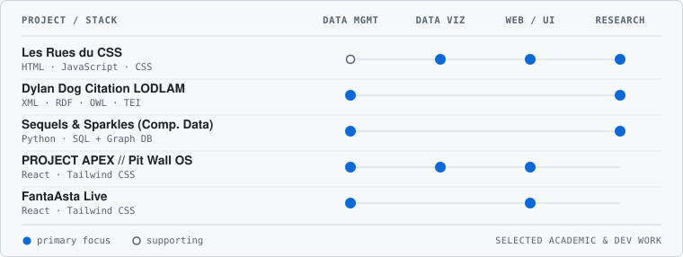

# Alessandro Rocchi

MSc student in **Digital Humanities and Digital Knowledge**.  
I design and build projects across data management, data visualization, semantic modeling, and web interfaces—working comfortably between research specifications and production code.

<picture>
  <source media="(prefers-color-scheme: dark)" srcset="assets/matrix-dark.svg">
  <source media="(prefers-color-scheme: light)" srcset="assets/matrix-light.svg">
  
</picture>

## Selected Work

| Project | Summary | Stack | Link |
| :--- | :--- | :--- | :--- |
| **Les Rues du CSS** | Multimedia exploration of Paris through film, combining interactive maps and themed layouts. | `HTML` `JavaScript` `CSS` | [Repository](https://github.com/Alessandro-Rocchi/project_Web_Technologies) |
| **Dylan Dog Citation LODLAM Project** | Research workflow for modeling and publishing Linked Open Data extracted from a Wikipedia source. | `XML` `RDF` `OWL` `TEI` | [Repository](https://github.com/Alessandro-RocchiInformationScienceandCH)  |
| **Computational Management of Data — Sequels and Sparkles!** | Hybrid query handler in Python that queries a relational database and a graph database and merges the results. | `Python` `SQL` `Graph DB` | [Repository](https://github.com/Alessandro-Rocchi/project_CompData) |
| **PROJECT APEX // Pit Wall OS & Motorsport Manager** | Motorsport management game with a data-heavy pit wall interface. | `React` `Tailwind CSS` | [Repository](https://github.com/Alessandro-Rocchi/project-apex) |
| **FantaAsta Live** | Live fantasy football auction web application. | `React` `Tailwind CSS` | [Repository](https://github.com/Alessandro-Rocchi/fantafootball-project) |

## Tools & Methods

- **Data & Semantic Modeling:** Python, relational & graph databases, XML, TEI, RDF, OWL
- **Web & Interfaces:** HTML, CSS, JavaScript, React, Tailwind CSS

<!--
## Contact

- Email: your-email@example.com
- LinkedIn: https://www.linkedin.com/in/your-handle/
- Website / ORCID: https://example.com
-->
